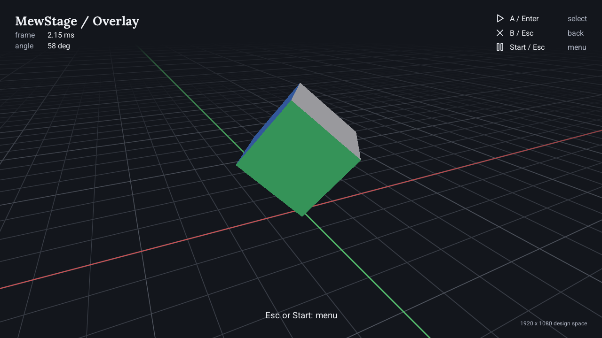
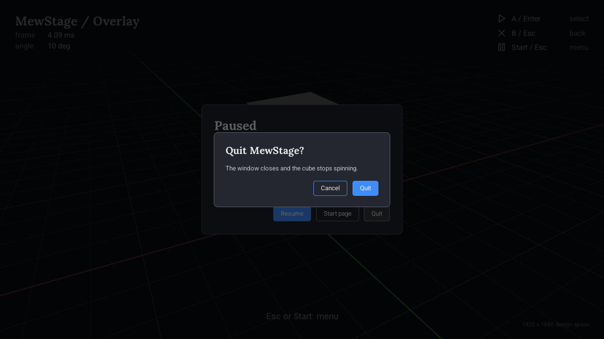
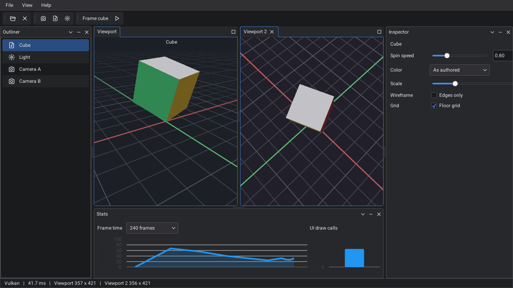
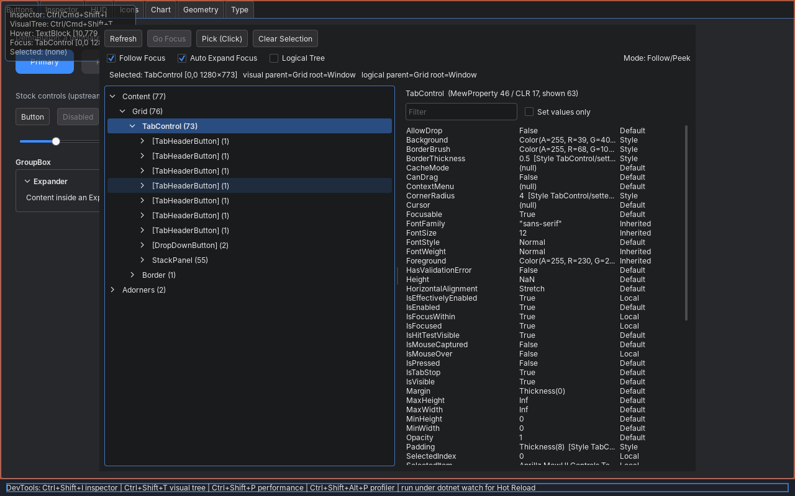

# MewStage

MewStage runs MewUI inside a 3D application's own frame, instead of the other way around.

[MewUI](https://github.com/aprillz/MewUI) is a code-first, NativeAOT-compatible UI framework for .NET, and
[MewVG](https://github.com/aprillz/MewVG) is the vector renderer it draws with. Out of the box, MewUI opens its own
windows and runs its own frame loop. That works well for a desktop tool. A game or a 3D editor already owns a window,
a GPU device and a frame, and needs the UI to be one more pass inside that frame. MewStage is a complete, runnable
example of doing that, along with the pieces an application needs to do it too. The code was extracted from a private
game and tool codebase and cleaned up to stand on its own. Everything here is MIT licensed.



## Why this exists

A UI framework that runs embedded gives up a few things it normally owns. The window belongs to someone else
now, so the host has to tell it how big it is and when the mouse moved. Its drawing has to go through the
application's GPU device, in the application's frame, with the application's synchronization. And there's no message
loop anymore. The host has to pump the dispatcher and tick the animations itself, once per frame.

MewUI's internals turn out to be built around a handful of contracts that make this possible (a window backend, a graphics
factory, a render surface, a text contract and a per-frame animation pulse). None of them is public API for a
third-party backend, and MewStage implements all of them over a real GPU device.

Everything the UI draws ends up in one `ui` render-graph pass per frame, which composites every visible MewUI window
from bottom to top. A game points that pass at the backbuffer after the world is drawn, and the HUD, pause menu and
dialog all land in that one pass over the game. An editor points it at a cleared target and puts 3D viewports inside
the UI. Each viewport is an offscreen render target that MewUI samples as an image, with no copy. The vendored UI
framework never sees which GPU API is underneath. The same code runs on DX12 and Vulkan, and publishes with NativeAOT.

MewUI and MewVG have needed some patching, since an embedded host asks for things MewUI's own platform host doesn't
need, like several hosts living in one process, supporting window layout below scale 1 (so a 1920 x 1080
HUD scales down to a 1280 x 720 backbuffer), and a steady-state frame should allocate nothing on the managed heap. Each patch is
small and marked as mandatory or optional, and docs/vendoring.md explains every one.

## What is here and what is not

Treat this as a working demonstration. It can be the base an app is built on, or a reference while parts of it are
swapped for existing libraries. Only `MewStage.Host` depends on SDL3, and another windowing layer can take its place.
The UI backend compiles only against `IGraphicsDevice`, and an engine with its own renderer can implement that
interface over it and keep the rest. The headless device in the tests is a small example of one.

MewUI and MewVG are vendored at pinned commits with a recorded patch set, instead of coming from NuGet, because the
backend compiles against their internals.

Some things are missing. There is no macOS or Metal backend, only a stub that holds its place. There are no file
dialogs, and text input method editors only get what SDL delivers. The Workbench sizes its viewport from the previous
frame's layout, which shows the old image stretched for one frame during a resize. The in-window DevTools work on the
embedded host in a Debug build, while the two that open their own windows need Kit mode.

CI runs the lavapipe suites, the Xvfb Kit smoke and the Linux AOT publish on every push. DX12 on real hardware and
the Windows AOT publish are checked by hand (docs/hand-test.md).

## The three modes

### Overlay

A rotating lit cube fills the window and MewUI draws over it. The HUD is transparent and laid out in a fixed
1920 x 1080 design space. Escape opens a pause menu with a ComboBox, a slider, a switch and a text box, and Quit opens
a dialog that fades in over it. All three windows composite in one pass, and the keyboard, mouse and gamepad drive the
same commands.



### Workbench

The Workbench is a desktop tool window with a menu bar and an SVG icon toolbar. Docked panels hold an outliner, an
inspector and a frame-time chart around one or two 3D viewports, which render offscreen and show as images inside the
UI. The dock layout is saved between runs. The chart can detach into a second OS window, and an edit in the inspector
shows in both viewports on the next frame.



### Kit (`--standard`)

Kit mode runs the same controls, styles and view models on MewUI's own platform host, without the SDL window or the
application's GPU device. It's the mode for MewUI's development tools. The element inspector, live visual tree,
performance monitor and profiler all work here, along with Hot Reload under `dotnet watch` and the editor preview.
There are no 3D views in Kit mode, because MewUI's own platform host has no application device to render them with.
Text is rasterized by the platform instead of the embedded host, and its pixels differ slightly.



## Quick start

The .NET 10 SDK is the only requirement. SDL3's native library comes from a NuGet package. On Windows the demo runs
on DX12 by default, or on Vulkan with a flag. On Linux it runs on Vulkan, and Kit mode needs an X11 display.

    git clone https://github.com/richard-sim/MewStage
    cd MewStage
    dotnet run --project src/MewStage.Demo

That opens the start page, where you pick a mode. To start straight in one:

    dotnet run --project src/MewStage.Demo -- --overlay
    dotnet run --project src/MewStage.Demo -- --workbench --render-vk
    dotnet run --project src/MewStage.Demo -- --standard

`--render-dx12` and `--render-vk` pick the GPU API, and `--warp` uses the DX12 software adapter.

| Mode | Key | Action |
| --- | --- | --- |
| Overlay | Escape, or Start on a gamepad | open the pause menu |
| Workbench | left-drag in the viewport | orbit |
| Workbench | middle-drag, or Shift + left-drag | pan |
| Workbench | mouse wheel | zoom |
| Workbench | F | frame the cube |
| Workbench | Ctrl+2 | show a second viewport |
| Workbench | Ctrl+Shift+S | detach the stats chart |
| any, Debug build | Ctrl+Shift+I / Ctrl+Shift+P | MewUI's inspector / performance monitor |
| Kit, Debug build | Ctrl+Shift+T / Ctrl+Shift+Alt+P | the live visual tree / the profiler |

docs/devtools.md explains which DevTools work on which host.

To run the tests:

    dotnet test MewStage.sln

That runs the headless tests. The rendered tests need Vulkan and use Mesa's lavapipe, a software implementation that
works on machines with no GPU. On Linux, run `bash scripts/ci-vulkan-render-test.sh dotnet`. On Windows, restore
lavapipe once and run `python scripts/vk_lavapipe.py -- dotnet test tests/MewStage.Demo.Tests`. Each rendered suite
prints how many of its gated tests ran. If a suite reports zero, the setup is broken, even though the run shows green
(docs/testing.md).

To publish with NativeAOT:

    dotnet publish src/MewStage.Demo -c Release -r win-x64 -p:PublishAot=true -o publish/win-x64

The output folder is self-contained. It holds the executable, SDL3, the fonts and icons, and the cooked shaders.
Published binaries leave out the DevTools, because their property panel uses reflection and upstream MewUI turns them
off under trimming.

## How it works

The application owns an SDL3 window, a GPU device, a scheduler with frames in flight, and a render graph that is
rebuilt every frame.

MewUI sees a fake window backend that reports a size, counts invalidations, and has a non-zero handle so layout runs.
Its graphics factory sits on top of the application's device, and its render surface is a color texture with a
stencil. Fonts go through FontStashSharp using each face's real metrics, which lets text measure exactly as it draws
without touching the GPU. Each frame the host pulses MewUI's animation clocks, lays out any dirty windows, and adds one
pass to the graph.

The pass writes its target, either clearing it or loading what the world drew. It also reads every viewport texture
the application declared and creates one transient stencil, and the graph compiler adds the barriers. Inside the
pass, every window renders into a single MewVG frame through the application's NanoVG-style renderer and one HLSL
shader, and that frame is flushed once. A viewport is a MewUI control whose `OnRender` draws an image. The image is a
registry key that resolves to the offscreen target's shader-resource view, and a stale key resolves to nothing instead
of to freed memory.

docs/mewui-embedding.md has the longer version, with each host contract and the rules the renderer follows.
docs/architecture.md covers the project layering, the frame and the AOT settings.

## How to create your own app

The libraries under `src/` are meant to be taken as a set and the demo thrown away. In dependency order:

- `Graphics`: the GPU device seam
- `Rendering`: the DX12 and Vulkan backends, the render graph and the scheduler
- `Input`: the keyboard, mouse and gamepad snapshot types
- `Ui.Navigation`: the navigation commands and focus helpers for keyboard and gamepad
- `Ui.Backend`: the embedded MewUI host
- `Host`: the SDL window and the frame loop
- `Viewport`: offscreen render targets as UI controls

`Scene` is the demo's cube, and your app will have its own.

A project needs three things, all shown in the project file below:

1. References to `MewStage.Host`, `MewStage.Ui.Backend` and the vendored MewUI project.
2. The `assets` folder copied beside the executable. The host needs the UI shader and the asset-root marker from it;
   the fonts and icons are only the demo's.
3. An import of `third_party/MewUI.Consumer.targets` at the end of the project file. It brings in MewUI's binding
   source generator and feature switches, as the NuGet package would.

With MewStage checked out beside your project:

```xml
<Project Sdk="Microsoft.NET.Sdk">
  <PropertyGroup>
    <OutputType>Exe</OutputType>
    <TargetFramework>net10.0</TargetFramework>
    <Nullable>enable</Nullable>
    <ImplicitUsings>enable</ImplicitUsings>
  </PropertyGroup>
  <ItemGroup>
    <ProjectReference Include="../MewStage/src/MewStage.Host/MewStage.Host.csproj" />
    <ProjectReference Include="../MewStage/src/MewStage.Ui.Backend/MewStage.Ui.Backend.csproj" />
    <ProjectReference Include="../MewStage/third_party/MewUI/src/MewUI/MewUI.csproj" />
    <None Include="../MewStage/assets/**" Link="assets/%(RecursiveDir)%(Filename)%(Extension)" CopyToOutputDirectory="PreserveNewest" />
  </ItemGroup>
  <PropertyGroup>
    <MewStageUiHost>Tool</MewStageUiHost>
  </PropertyGroup>
  <Import Project="../MewStage/third_party/MewUI.Consumer.targets" />
</Project>
```

And the program:

```csharp
using Aprillz.MewUI;
using Aprillz.MewUI.Controls;
using MewStage.Host;

// The window, the device (DX12 on Windows, Vulkan elsewhere), the scheduler, the graph and the UI host.
using var host = new AppHost(GpuBackends.Select(args), "My app", 1280, 720,
    registerFonts: null, designWidth: 0, designHeight: 0);

// A MewUI window on the embedded host. Nothing is drawn under it, so the ui pass clears to Background.
Window window = new Window { Padding = Thickness.Zero }
    .Content(new TextBlock().Text("Hello from inside the frame").FontSize(32).Center());
host.Ui.SetWindow(window);

// Your world: passes added to the graph before the ui pass, into the backbuffer or your own targets. Once
// something draws under the UI, set host.UiClearsBackground = false so the ui pass LOADs instead of clearing.
host.BeforeUi = (graph, backbuffer) => { /* graph.AddPass(...) */ };

host.Run();
```

That's the whole application. It opens a window with centered text, drawn by MewUI through the application's GPU
device inside its frame. This exact program has been built and run on Vulkan under Linux.

The demo covers the four things most apps add next:

- For a HUD over a world, give the host a design space (`designWidth: 1920, designHeight: 1080`) and a transparent
  window. The host scales the layout to the backbuffer and maps the pointer through the same scale
  (`src/MewStage.Demo/Overlay`).
- For a menu over a HUD, push a second window with `host.Ui.SetWindows(stack)`. Only the top window takes input
  (`PauseMenu`, `QuitDialog`).
- For a 3D view inside the UI, put a `ViewportControl` in the layout and attach it to a `ViewportCompositor` with your
  own `IViewportSceneRenderer`. Call the compositor's `AddViewportPasses` in `BeforeUi` and `AddTerminalPasses` in
  `AfterUi` (`src/MewStage.Demo/Workbench`).
- Input works through `NavCommands`. Register their handlers on the window and bind buttons to the same commands, and
  a key, a gamepad button and a click all run one handler.

## Layout

    src/            the nine projects (docs/architecture.md)
    tests/          five test projects (docs/testing.md)
    assets/         fonts (Roboto, Lora; SIL OFL), SVG icons, HLSL shaders and the cooked DXIL / SPIR-V blobs
    third_party/    MewUI, MewVG and three extensions, vendored at pinned commits with patches (docs/vendoring.md)
    scripts/        shader cooking, the lavapipe wrappers, the Kit smoke, the format gate
    docs/           architecture, embedding, vendoring, testing, devtools, hand-test

## License

MIT. The vendored components keep their own licenses; `third_party/NOTICE` lists them with every patch applied.
